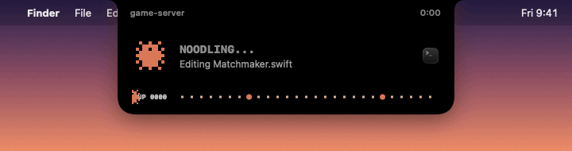
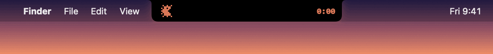
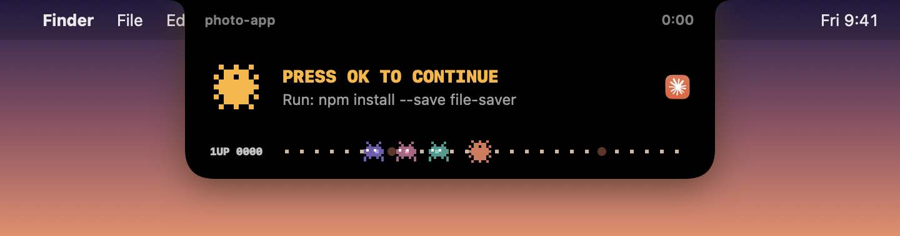
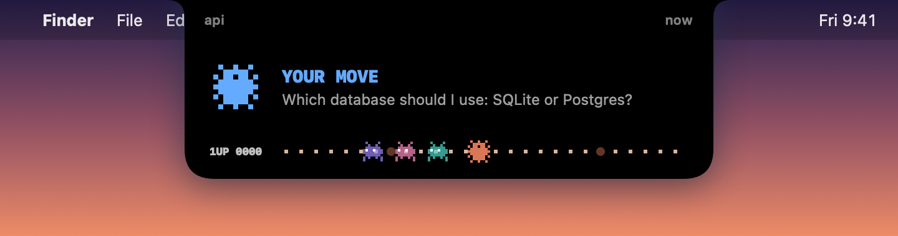
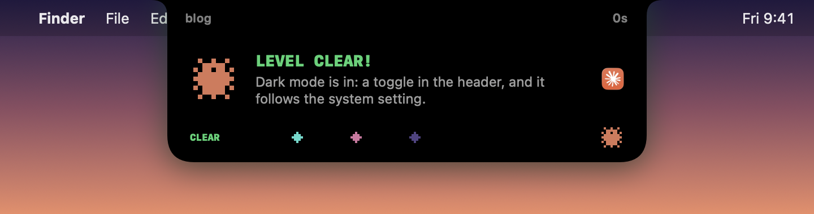
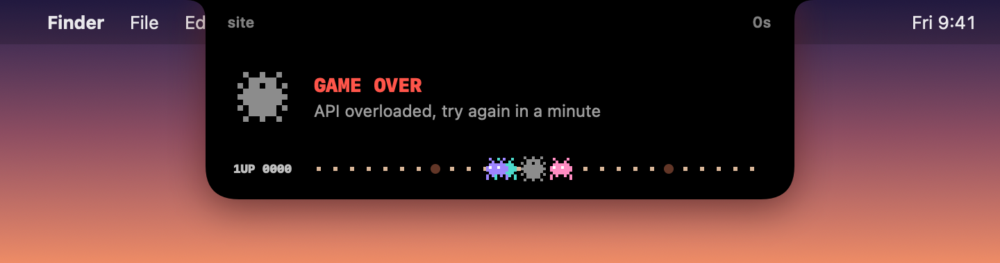
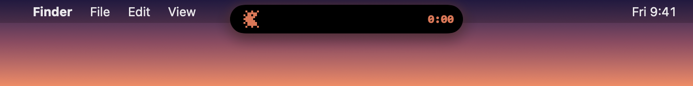
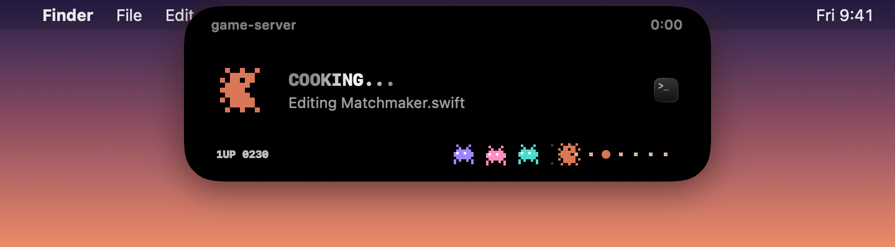
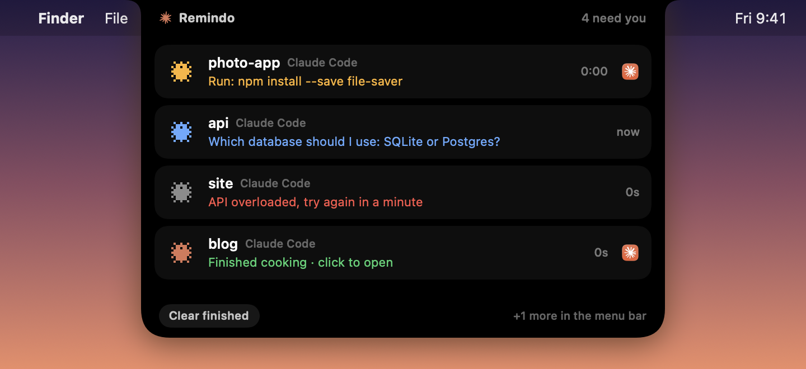

# Remindo 🕹️

**A tiny arcade game in your MacBook's notch that tells you what Claude Code is doing.**

While Claude Code works, a pixel spark chomps its way along your notch. When Claude
**needs your approval**, **asks you a question**, or **finishes**, a card drops out of the
notch, and it reminds you again when you switch apps, change Spaces, or come back to
your Mac, so you never leave Claude waiting.

<p align="center">
  
</p>

**While Claude works**, the spark sits in your notch, chomping, with a timer:

<p align="center">
  
</p>

**When Claude needs you or finishes**, a card drops out of the notch:

| Needs your approval | Has a question |
|---|---|
|  |  |
| **Finished** | **Hit an error** |
|  |  |

**No notch? You get a Dynamic Island.** On iMacs, external displays and Macs without a
notch, Remindo floats as an island pill at the top of the screen:

<p align="center">
  
  
</p>

**Hover the notch** to see every agent at once; click one to jump back to it:

<p align="center">
  
</p>

- Works with **Claude Code** in any terminal or IDE, and inside the **Claude desktop app** (Code tab)
- **Hover** the notch to see every session; **click** one to jump back to its app
- Remembers you even when you're away: reminders on app switch, Space change, wake/unlock
- Arcade style (retro pixels) or a smooth animated spark, your choice
- Any other agent or script can plug in through the `remindo` command
- 100% local: everything stays on your Mac

---

## Compatibility

| | Supported |
|---|---|
| **macOS** | 14 Sonoma, 15 Sequoia, 26 Tahoe, and newer |
| **Macs** | Apple Silicon (M1 to M4 and later) and Intel: one universal app |
| **Screens** | MacBooks with a notch: it grows out of the notch. Everything else (iMac, external displays, Macs without a notch): a floating Dynamic Island |
| **Claude Code** | In any terminal (Terminal, iTerm2, Ghostty, Warp…), in VS Code / Cursor, and in the Claude desktop app |

## Requirements

- **macOS 14 or newer**, on any Mac (Apple Silicon or Intel).
- **Xcode Command Line Tools**, only to build from source: `xcode-select --install`.
- **Claude Code** ([install it](https://docs.anthropic.com/en/docs/claude-code)).

Nothing else: linking Claude Code uses `jq` when it's installed, and macOS's built-in
JavaScript engine otherwise.

## Install (2 minutes)

```bash
git clone https://github.com/realsmt99/remindo.git
cd remindo
./scripts/install.sh
```

That's it. The installer:

1. builds the app and puts it in `~/Applications/Remindo.app`
2. installs the `remindo` command (in `~/.remindo/bin`, linked from `~/.local/bin`)
3. **connects Claude Code** (see below), after saving a backup of your settings
4. starts Remindo: look for the ✳ spark in your menu bar

Then watch a demo game on your notch:

```bash
remindo test
```

> If your terminal says `remindo: command not found`, add `~/.local/bin` to your PATH once:
> ```bash
> echo 'export PATH="$HOME/.local/bin:$PATH"' >> ~/.zshrc && source ~/.zshrc
> ```

### Or: download the app

Prefer not to build it yourself? Grab **Remindo.zip** from the
[latest release](https://github.com/realsmt99/remindo/releases/latest), unzip it, and move
**Remindo.app** to your Applications folder.

Remindo isn't notarized by Apple, so the first time macOS will refuse to open it. Allow it once:

```bash
xattr -dr com.apple.quarantine /Applications/Remindo.app
open /Applications/Remindo.app
```

(Or right-click the app → **Open** → **Open**.) Then click the ✳ in the menu bar →
**Link Claude Code…** to connect it.

---

## Connect it to Claude Code

### Automatic (recommended)

`./scripts/install.sh` connects it for you. You can also do it any time with:

```bash
remindo install-claude
```

or from the menu bar: ✳ → **Link Claude Code…**

This adds [hooks](https://docs.anthropic.com/en/docs/claude-code/hooks) to your **user**
Claude Code settings (`~/.claude/settings.json`). Your other settings and hooks are kept, and
a backup is saved next to the file (`settings.json.remindo-backup.<date>`). Running it again
is safe: it never adds duplicates.

**Then restart any Claude Code sessions that were already open.** New sessions pick up the
hooks automatically: in the terminal, in VS Code / Cursor, and in the Claude desktop app.

### Check that it works

```bash
remindo doctor
```

```
• CLI at ~/.remindo/bin/remindo: ok
• Remindo app on http://127.0.0.1:47474: running
• Claude Code hooks in ~/.claude/settings.json: linked
• jq: ok
All good ✨
```

Now start Claude Code, give it a task, and switch to another app: the notch shows the game
while it cooks, and pings you when it needs you or finishes.

### Manual setup (if you manage settings.json yourself)

Every hook runs the same command, `~/.remindo/bin/remindo hook claude-code`, which forwards
Claude Code's hook JSON to the Remindo app. Add this to the `hooks` section of
`~/.claude/settings.json` (or a project's `.claude/settings.json`), replacing `YOU` with your
username:

```json
{
  "hooks": {
    "SessionStart":       [{ "hooks": [{ "type": "command", "command": "'/Users/YOU/.remindo/bin/remindo' hook claude-code", "timeout": 10 }] }],
    "UserPromptSubmit":   [{ "hooks": [{ "type": "command", "command": "'/Users/YOU/.remindo/bin/remindo' hook claude-code", "timeout": 10 }] }],
    "PreToolUse":         [{ "matcher": "*", "hooks": [{ "type": "command", "command": "'/Users/YOU/.remindo/bin/remindo' hook claude-code", "timeout": 10, "async": true }] }],
    "PermissionRequest":  [{ "matcher": "*", "hooks": [{ "type": "command", "command": "'/Users/YOU/.remindo/bin/remindo' hook claude-code", "timeout": 10 }] }],
    "PostToolUse":        [{ "matcher": "*", "hooks": [{ "type": "command", "command": "'/Users/YOU/.remindo/bin/remindo' hook claude-code", "timeout": 10, "async": true }] }],
    "PostToolUseFailure": [{ "matcher": "*", "hooks": [{ "type": "command", "command": "'/Users/YOU/.remindo/bin/remindo' hook claude-code", "timeout": 10, "async": true }] }],
    "PermissionDenied":   [{ "matcher": "*", "hooks": [{ "type": "command", "command": "'/Users/YOU/.remindo/bin/remindo' hook claude-code", "timeout": 10, "async": true }] }],
    "Notification":       [{ "hooks": [{ "type": "command", "command": "'/Users/YOU/.remindo/bin/remindo' hook claude-code", "timeout": 10 }] }],
    "Elicitation":        [{ "hooks": [{ "type": "command", "command": "'/Users/YOU/.remindo/bin/remindo' hook claude-code", "timeout": 10 }] }],
    "ElicitationResult":  [{ "hooks": [{ "type": "command", "command": "'/Users/YOU/.remindo/bin/remindo' hook claude-code", "timeout": 10 }] }],
    "Stop":               [{ "hooks": [{ "type": "command", "command": "'/Users/YOU/.remindo/bin/remindo' hook claude-code", "timeout": 10 }] }],
    "StopFailure":        [{ "hooks": [{ "type": "command", "command": "'/Users/YOU/.remindo/bin/remindo' hook claude-code", "timeout": 10 }] }],
    "SubagentStart":      [{ "hooks": [{ "type": "command", "command": "'/Users/YOU/.remindo/bin/remindo' hook claude-code", "timeout": 10, "async": true }] }],
    "SubagentStop":       [{ "hooks": [{ "type": "command", "command": "'/Users/YOU/.remindo/bin/remindo' hook claude-code", "timeout": 10, "async": true }] }],
    "PreCompact":         [{ "hooks": [{ "type": "command", "command": "'/Users/YOU/.remindo/bin/remindo' hook claude-code", "timeout": 10, "async": true }] }],
    "SessionEnd":         [{ "hooks": [{ "type": "command", "command": "'/Users/YOU/.remindo/bin/remindo' hook claude-code", "timeout": 10 }] }]
  }
}
```

The minimum useful set is `UserPromptSubmit`, `PermissionRequest`, `Notification` and `Stop`;
the others make the live status richer. The hook command never prints anything and always
exits 0, even when Remindo isn't running, so it can't block or slow Claude Code. The frequent
tool hooks run with `async: true`.

### Disconnect

```bash
remindo uninstall-claude
```

Removes only Remindo's hooks; everything else in your settings stays.

---

## Everyday use

| Command | What it does |
|---|---|
| `remindo go` | start Remindo |
| `remindo stop` | quit Remindo |
| `remindo test` | play the demo (`working`, `approval`, `question`, `done`, `error`) |
| `remindo status` | what Remindo is tracking right now |
| `remindo doctor` | check the setup |

Click the ✳ in the menu bar for:

- **Preview the notch**: every animation
- **Remind me when I switch apps or Spaces**
- **Show live activity while agents work**: the chomping spark in the notch's wings
- **Repeat reminders for approvals**: every 90 s while you're elsewhere
- **Remind me even inside the agent's app**
- **Play sounds**
- **Arcade style (retro pixels)**: switch between the game and the smooth spark
- **Floating island (even with a notch)**: use the Dynamic Island look on a notched MacBook too
- **Show on**: the notch display or whichever display you're using
- **Launch at login**
- **Link / unlink Claude Code**

---

## Connect other agents

Remindo understands Claude-Code-style hook JSON from any agent:

```bash
some-agent-hook | ~/.remindo/bin/remindo hook my-agent
```

**Codex CLI**: add to `~/.codex/config.toml` (replace `YOU`):

```toml
notify = ["/Users/YOU/.remindo/bin/remindo", "hook", "codex"]
```

**Anything else** (scripts, CI, long builds):

```bash
remindo notify --agent my-build --state working --message "Compiling…"
remindo notify --agent my-build --state done --title "Build finished" --message "All tests pass"
remindo notify --agent my-bot --state approval --message "Deploy to production?"
```

States: `working`, `done`, `approval`, `waiting`, `error`, `idle`, `end`.

Raw HTTP (loopback only; needs your private token):

```bash
curl --noproxy '*' -H 'X-Remindo-Client: me' -H "X-Remindo-Token: $(cat ~/.remindo/token)" \
     --data-urlencode state=done --data-urlencode message=Shipped \
     "http://127.0.0.1:$(cat ~/.remindo/port)/v1/event"
```

---

## Troubleshooting

| Problem | Fix |
|---|---|
| `remindo: command not found` | Add `~/.local/bin` to PATH (see Install), or use `~/.remindo/bin/remindo` |
| `Remindo isn't running` | `remindo go` (turn on **Launch at login** in the menu to keep it running) |
| Notch never lights up for Claude Code | Run `remindo doctor`, then **restart your Claude Code session** so it loads the hooks |
| Can't see the ✳ in the menu bar | A full menu bar hides icons behind the notch. Hover the notch instead, or remove some menu bar icons |
| "Remindo can't be opened" | See the `xattr` step under **Download the app** |
| Port 47474 is taken | Remindo picks the next free port automatically and tells the CLI via `~/.remindo/port` |

---

## How it works

```
Claude Code ──hook──▶ ~/.remindo/bin/remindo ──HTTP 127.0.0.1──▶ Remindo.app ──▶ your notch
```

- Hooks send Claude Code's events to a tiny local server inside Remindo. It only listens on
  `127.0.0.1`, refuses browser requests, and requires a private per-user token
  (`~/.remindo/token`).
- Remindo works out which app runs each session (Terminal, iTerm, VS Code, Cursor, the
  Claude app…) so a click brings you straight back there.
- Esc-interrupted turns, background agents and out-of-order events are handled, so nothing
  stays stuck on "cooking".
- Nothing leaves your Mac.

## Build from source

```bash
swift build                                  # debug build
.build/debug/Remindo                         # run without installing
.build/debug/Remindo --snapshot /tmp/shots   # render every notch state to PNGs
.build/debug/Remindo --readme-shots docs/images  # regenerate the README pictures and GIFs
./scripts/build.sh                           # build/Remindo.app
```

## Uninstall

```bash
./scripts/uninstall.sh
```

Removes the Claude Code hooks, the login item, the app, `~/.remindo` and Remindo's preferences.

## License

[MIT](LICENSE) © 2026 Amine Menadi. Not affiliated with Anthropic.
